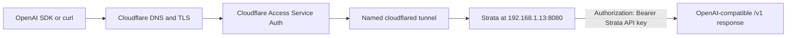

# Strata Named Cloudflare Tunnel Design

## Goal

Publish the already-running Strata OpenAI-compatible API on `192.168.1.13:8080` at a stable Cloudflare hostname, for example `https://llm.example.com/v1`. Keep the current model server running, expose no inbound router ports, and require both Cloudflare Access and Strata API authentication for programmatic clients.

This design follows [`cloudflared-tunnel-setup.md`](../../cloudflared-tunnel-setup.md), with two current-doc corrections noted below. The Cloudflare zone is already available, so only the exact domain and chosen subdomain remain deployment inputs.

## Existing Strata behavior

Strata already has a temporary Cloudflare Quick Tunnel option. It starts a foreground `cloudflared tunnel --url` process, gets a random `trycloudflare.com` address, and ties that process to the Strata launch. A named tunnel has a stable DNS name and a separate system service lifetime, so it should be a distinct option and must not reuse the Quick Tunnel process lifecycle.

The current server already serves the OpenAI API under `/v1` and checks its own API key. The new tunnel feature should not change the model server, disable that key, or restart the active model service.

## Request path



Use two independent credentials:

1. Cloudflare service token headers authenticate the client at Access.
2. `Authorization: Bearer <STRATA_API_KEY>` authenticates the request at Strata.

For OpenAI SDK clients, set the base URL to `https://<SUBDOMAIN>.<DOMAIN>/v1`, keep the Strata key as the SDK API key, and add `CF-Access-Client-Id` and `CF-Access-Client-Secret` as default headers.

## Routing and exposure

Use a locally-managed, named tunnel on the Ubuntu host. The origin is exactly `http://192.168.1.13:8080`; do not put `/v1` in the origin URL. `cloudflared` forwards the request path unchanged, so an external request to `/v1/models` reaches Strata as `/v1/models`.

The tunnel ingress should allow only Strata's API path and return 404 for every other path:

```yaml
tunnel: <TUNNEL_UUID>
credentials-file: /etc/cloudflared/<TUNNEL_UUID>.json

ingress:
  - hostname: <SUBDOMAIN>.<DOMAIN>
    path: '^/v1(/.*)?$'
    service: http://192.168.1.13:8080
    originRequest:
      connectTimeout: 30s
  - service: http_status:404
```

The regex includes both `/v1` and `/v1/...`, while excluding paths such as `/`, `/health`, and `/v10`. Keep the final catch-all rule. Protect the hostname with a Cloudflare Access self-hosted application and a default-deny `Service Auth` policy that includes only the intended service token(s). This makes the API usable from SDKs and curl without publishing Strata's browser UI or other server routes.

Create the Access application and policy before creating the public DNS route, so there is no unprotected interval. The DNS record should point to the tunnel; it does not point to `192.168.1.13` and does not require a router port-forward.

## Setup workflow

Add a separate named-tunnel workflow rather than changing the meaning of the existing Quick Tunnel choice:

1. `strata tunnel check` — read-only checks for the active API, origin API-key enforcement, `cloudflared`, config validity, and outbound tunnel connectivity.
2. `strata tunnel setup` — collect tunnel name and `api.<domain>` hostname; guide the operator through Cloudflare login; create a locally-managed tunnel; write the ingress config and credentials with restricted permissions; create the Access application and Service Auth policy (Dashboard steps are acceptable for the first version); add the DNS route; install and enable the `cloudflared` systemd service.
3. `strata tunnel status` — show the public base URL, tunnel connector state, systemd state, origin reachability, and Access setup reminder. Never print a tunnel credential, API key, service-token secret, or full secret-bearing command line.
4. `strata tunnel restart|stop|start` — control only the `cloudflared` system service. Starting or stopping Strata must not silently remove or stop a named tunnel.
5. `strata tunnel remove` — require an explicit confirmation before disabling the service and removing local config. Do not revoke Cloudflare Access tokens or delete the remote DNS record unless the operator explicitly selects those actions.

The setup command should never store a Cloudflare API token or service-token secret in a Strata model preset. Keep the tunnel credential file readable only by root (`0600`); keep API client secrets in the client's secret store or environment, not in checked-in files.

## Access policy and client example

Use a Cloudflare Access `Service Auth` policy for machine clients. Email OTP is suitable for interactive browser access, but not for a normal OpenAI SDK request. Create a separate service token for each external client or integration so it can be rotated or revoked independently. Enable the app's 401 response for failed Service Auth requests (and strict service-token authentication if available in the Zero Trust organization).

```bash
curl https://<SUBDOMAIN>.<DOMAIN>/v1/models \
  -H 'CF-Access-Client-Id: <CLIENT_ID>' \
  -H 'CF-Access-Client-Secret: <CLIENT_SECRET>' \
  -H 'Authorization: Bearer <STRATA_API_KEY>'
```

For long generations, use streaming (`stream: true`) and validate a long prompt from the actual external client. Cloudflare documents a default 125-second proxy read timeout; requests that do not begin returning response data in time can fail with 524. Streaming helps once Strata starts emitting events, but it cannot fix an excessively long wait before the first response bytes.

## Checks before setup

- Confirm the existing service responds on `http://192.168.1.13:8080/v1/models`; without a Strata key, it should return Strata's authentication error.
- Confirm that the machine running `cloudflared` can reach `192.168.1.13:8080`. Since the service is already running, setup must not restart it.
- Confirm `cloudflared` can reach Cloudflare. Current Tunnel guidance allows outbound port `7844` over UDP for QUIC and/or TCP for HTTP/2; the plan's TCP-only statement is incomplete. Recent `cloudflared` versions run these connectivity checks at startup.
- Confirm the DNS zone is an active Cloudflare zone and collect the exact domain and chosen hostname.
- Confirm the intended external clients and create one Cloudflare service token per client.

## Acceptance criteria

1. `https://<SUBDOMAIN>.<DOMAIN>/v1/models` with no Access credentials is denied by Access with an API-friendly 401 response.
2. A valid Access service token without a Strata API key reaches Strata and receives its OpenAI-style authentication error.
3. Valid Access headers plus the Strata API key return the model list and complete an OpenAI-compatible chat request.
4. Streaming chat works through the public hostname for a representative long prompt.
5. `/`, `/health`, and a non-API path such as `/v10` return 404 through the tunnel.
6. `cloudflared` reconnects after a host reboot; the Strata service retains its current independent lifecycle.
7. No inbound router port is opened, and the public DNS record does not reveal the origin IP.

## Strata integration points

- `strata_cli/launch/access.py` currently owns Quick Tunnel discovery and process lifecycle. Keep that code path intact; add named-tunnel state/status as a separate path.
- `strata_cli/launch/settings.py` and `screens.py` currently present a single Cloudflare Quick Tunnel choice. If the setup UI exposes the new mode, label the two choices explicitly as **Quick Tunnel (temporary URL)** and **Named Tunnel (DNS + Access)**.
- `strata_cli/launch/runner.py` currently stops its own Quick Tunnel when the Strata launch ends. The named systemd service must not be stopped from that cleanup path.
- The named tunnel's public URL can be shown in the Monitor Connect view, while its credentials remain outside launch presets.

## Current Cloudflare references

- [Locally-managed tunnel configuration](https://developers.cloudflare.com/cloudflare-one/networks/connectors/cloudflare-tunnel/do-more-with-tunnels/local-management/configuration-file/)
- [Route DNS to a tunnel](https://developers.cloudflare.com/cloudflare-one/networks/connectors/cloudflare-tunnel/routing-to-tunnel/dns/)
- [Service tokens and strict service-token authentication](https://developers.cloudflare.com/cloudflare-one/access-controls/service-credentials/service-tokens/)
- [Cloudflare Access application paths](https://developers.cloudflare.com/cloudflare-one/access-controls/policies/app-paths/)
- [Tunnel firewall requirements](https://developers.cloudflare.com/cloudflare-one/networks/connectors/cloudflare-tunnel/configure-tunnels/tunnel-with-firewall/)
- [Cloudflare 524 timeout](https://developers.cloudflare.com/support/troubleshooting/http-status-codes/cloudflare-5xx-errors/error-524/)
